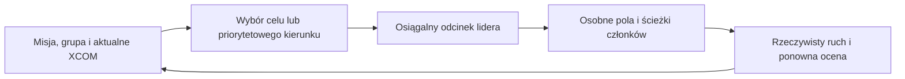

# Jak gra wybiera cel i drogę patrolu

Pochodne ustalenia z dostarczonego SDK WOTC i konfiguracji gry, 14 XI 2026.
Ścieżki UC poniżej są względne wobec `XComGame/Classes/`; źródeł SDK nie
publikujemy. To analiza mechanizmu, bez wykonania Windows make ani próby gry.

Hipoteza, że istnieją reguły wyboru punktów, jest **potwierdzona**. Pozwalają
one prognozować możliwe cele i podejścia. Nie wynika z nich jedna pewna trasa
na wiele tur: wybór może losować, reagować na XCOM i zmieniać priorytet.

## Wybór celu jest oddzielny od wyznaczania drogi

`XComGameState_AIGroup.ShouldMoveToIntercept:332–423` zawiera kilka gałęzi:

- Gdy XCOM minął grupę wzdłuż bieżącej osi gry i Kismet nie wyłączył
  interception, kierunkiem jest najbliższy żywy aktywny wróg grupy,
  a przy jego braku obiekt misji (`:352–360`).
- Przy `bInterceptObjectiveLocation` kierunkiem jest obiekt misji
  (`:363–367`). Stan ten może zmienić się po ukończeniu celu.
- W zwykłej gałęzi obchodu nowy punkt jest potrzebny, gdy stary cel jest
  dostatecznie stary, poza mapą albo grupa już się do niego zbliżyła.
  Gra buduje strefę encounter, bierze jej cztery narożniki, odrzuca zbyt
  bliskie i **losuje spośród pozostałych** przez `SYNC_RAND_STATIC`.
  Następnie ogranicza punkt do mapy i zapisuje cel wraz z turą AI.

Dostarczony `Config/DefaultAI.ini:20–21` ustawia maksymalny wiek na 2,
lecz kod sprawdza wiek **większy od 2**. Nie oznacza to automatycznego
wybierania punktu co dwie tury; dojście do celu może wywołać zmianę wcześniej.
Liczy się rzeczywiście załadowana konfiguracja i właściwy zegar AI.

## Mapa i misja określają obszar, lecz wejścia się zmieniają

Encounter ma szerokość, głębokość, offsety względem osi gry i opcjonalny
tag wyznaczonej strefy (`XComAISpawnManager:153–166`). Schedule misji określa
te parametry; nie jest to jednak uniwersalna lista punktów dla każdego wroga.
`BuildEncounterZone:227–235` dostaje również obiekt misji oraz **aktualną
pozycję XCOM**. Samo rozstawianie żołnierzy do zasadzki może więc zmienić
strefę używaną przy późniejszym wyborze celu patrolu.

`BuildEncounterZone` jest funkcją native. Znamy jej argumenty i typ wyniku,
ale dostarczony UC nie ujawnia ciała C++. Nie jest to powód żądania kolejnej
kopii tego samego SDK ani podstawa do deklarowania pełnej zgodności własnej
rekonstrukcji wszystkich przypadków mapy i volumes.

Alert, throttling, job lub cel drzewa zachowania mogą zastąpić zwykłe
patrolowanie. Pokazują to `XComGameState_AIPlayerData:617–711`,
`XGAIPatrolGroup.CheckForOverrideDestination:121–145` i
`XGAIBehavior.GreenAlertMovement:9184–9288`. Specjalne jednostki i misje
nie muszą wykonywać identycznej gałęzi. Zapisany waypoint nie dowodzi,
że pozostanie najwyższym priorytetem następnego ruchu.

## Wybrany punkt nie określa dokładnego przejścia całej grupy

`XGAIBehavior.HasValidDestinationToward:9651–9700` sprawdza osiągalność
i zasięg, dobiera dostępny fragment drogi oraz stosuje reachable fallback.
`XGAIPatrolGroup.ComputeGroupPath:333–363` buduje odcinek lidera przez
natywny cache osiągalności. Przeszkody, zajęte pola, wysokość i właściwości
ruchowe jednostki wpływają na rzeczywisty przebieg.

Followers dostają osobne miejsca formacji i osiągalne końce, z unikaniem
zajętych pól (`GetIdealFollowerDestinationTile:367–427`,
`GetGroupMovePaths:430–577`). Patrol nie przemieszcza wszystkich jednostek
jedną identyczną linią. Istniejący cache może opisywać już przebyty odcinek.

Graf `XComAlienPathNode.LinkedNodes` jest oznaczeniem możliwych korytarzy.
W sprawdzonym UC nie znaleziono zwykłego selektora patrolu wybierającego
kolejny cel po tych krawędziach. Łączenie grafu przez
`XComParcelManager.LinkParcelPatrolPathsToPlotPaths:526` jest native.
Nie dowodzi to, że native nigdy nie korzysta z grafu; nie pozwala też
przedstawiać go jako potwierdzonej przyszłej sekwencji danej grupy.

## Co można wykorzystać do zasadzki

Uzasadniony model to ograniczone drzewo możliwych następnych celów i korytarzy,
z jawną niepewnością. Świeży zapisany waypoint ma mocniejszą podstawę niż
dalsza przewidywana sekwencja. Jedna wymuszona gałąź może dawać bardzo dobrą
lokalną prognozę, jeżeli nadal obowiązują jej warunki i nie ma override.

Planer może wybierać osłony i linie ognia pokrywające kilka wariantów,
uwzględniać formację, LOS, własne AP i natywne warunki reakcji, ograniczać
oczekiwanie oraz przeliczać plan po rzeczywistym ruchu lub zmianie sytuacji.
Nie powinien wywoływać mutatorów patrolu, generować przyszłego RNG ani
traktować nieznanej gałęzi jako pustego korytarza. Pozostałe granice wiedzy
i legalności zachowuje [AGENTS](../AGENTS.md).

Znajomość reguł może znacznie poprawić zasadzkę. Nie gwarantuje przybycia
patrolu daną drogą, odpalenia Overwatch ani trafień. Perfekcyjna zasadzka
może udać się w konkretnej sytuacji; uniwersalna gwarancja nie wynika
z tego audytu. To uzasadnienie istniejącego etapu
[#88](https://github.com/HeisenbergC29/autoplay-xcom2/issues/88), nie nowa
gotowa implementacja ani rozszerzenie kolejki bez końca.
